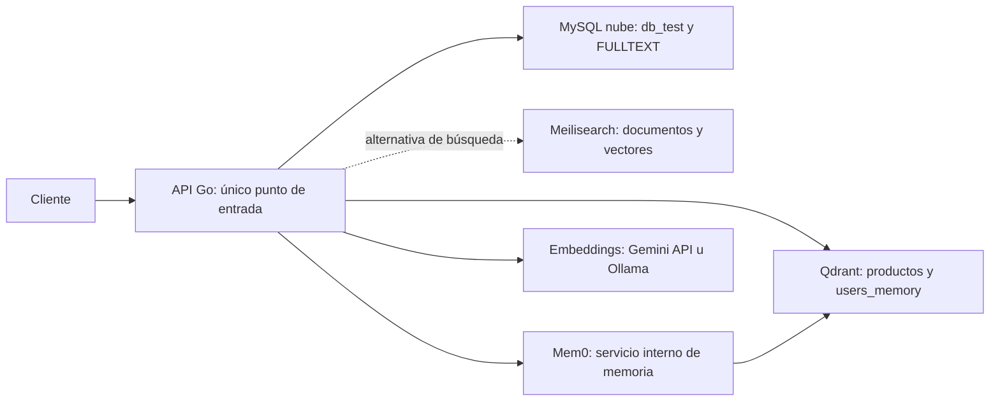

# API híbrida — Practicas_BDN_240545

Propuesta para el e-commerce de Base de Datos en la Nube. Únicamente se implementó un esqueleto Go: no se migró ni consultó la base, no se modificó `practica_04/` y no se crearon índices. Los 1000 productos, 504 relaciones del puente y los procedimientos son valores esperados proporcionados, no resultados verificados contra un servidor.

## Arranque y alcance del código

Requiere Go 1.22 o posterior y descargar el driver la primera vez:

```sh
cd api
go run .
```

Escucha en `localhost:8080` (el servidor enlaza `:8080`). Sin `MYSQL_DSN` arranca sin base. Con `MYSQL_DSN` configura un pool `database/sql`: por diseño la conexión física es diferida hasta la primera operación. No hay `Ping`, consultas ni DDL al arrancar. Esto permite revisar el esqueleto sin ejecutar nada en MySQL; la comprobación de credenciales queda para la implementación.

Exporta variables en el entorno de la terminal o en el panel del proveedor. `.env.example` es una plantilla y **no se carga automáticamente**. DSN ilustrativo, con credenciales reales solo en el entorno:

```text
usuario:contraseña@tcp(host-nube:puerto)/db_test?parseTime=true&charset=utf8mb4&tls=true
```

La URL `mysql://...` del proveedor no es directamente el DSN del driver. Usa host/puerto públicos para desarrollo local, o privados cuando Go y MySQL estén en la misma red del proveedor. El adaptador exige `tls=true`, con verificación de certificado y nombre de servidor; no utiliza `skip-verify`. Si el proveedor entrega una CA privada, falta implementar su registro con `mysql.RegisterTLSConfig` y ampliar la validación para aceptar ese perfil. Antes de usar Railway confirma/configura TLS verificado en el servicio; un proxy TCP por sí solo no aporta TLS.

Las cuatro rutas responden JSON `501 Not Implemented`; `q` vacío e IDs inválidos devuelven `400`. Métodos distintos reciben `405` por el router Go. No se simulan resultados. Los adaptadores vectoriales y de memoria solo definen contratos; no se conectan a servicios. `go.sum` fija las comprobaciones de las dependencias.

## MySQL nube: comparación y recomendación

Consulta documental: 11 de noviembre de 2026. Costos y disponibilidad deben confirmarse en el panel antes de contratar.

| Servicio | Adecuación a esta práctica | Costo y límites a considerar |
|---|---|---|
| PlanetScale (Vitess/MySQL) | Su capa Vitess introduce incompatibilidades con MySQL tradicional; los procedimientos almacenados son una limitación relevante para `p04_caso1_final` y `p04_caso2_error`. No es una migración transparente para esta práctica. | Revisar plan vigente y compatibilidad de FULLTEXT, rutinas y triggers antes de migrar. No se recomienda aquí. |
| **Railway — recomendado** | Plantilla MySQL, volumen persistente y despliegue de Go en el mismo proyecto. Permite conservar el motor MySQL y evaluar las rutinas sin rediseñar el esquema para Vitess. | Cobro según plan y recursos. Configurar persistencia, acceso, TLS y copias; no asumir gratuidad permanente. |
| Aiven for MySQL | Alternativa administrada con cifrado y copias; revisar privilegios de importación, `DEFINER` y compatibilidad de versión. | La página actual anuncia retiro del free tier MySQL para altas nuevas y Developer desde USD 5/mes. Hay páginas antiguas que todavía mencionan un plan gratuito. |

Recomiendo **Railway** por la facilidad de reunir Go y un MySQL convencional para una práctica pequeña; es una decisión de integración, no una afirmación de que sea el más barato. Antes de importar, verificar versión, FULLTEXT, rutinas, triggers y privilegios en una instancia de destino vacía.

Fuentes oficiales: [MySQL en Railway](https://docs.railway.com/databases/mysql), [planes Railway](https://docs.railway.com/pricing/plans), [limitaciones indicadas por PlanetScale](https://planetscale.com/blog/supports-notes-from-the-field), [retiro del free tier MySQL de Aiven](https://aiven.io/free-mysql-database-retired).

## Cómo subir db_test sin perder los datos (procedimiento manual futuro)

**Los siguientes comandos son instrucciones, no se ejecutaron.** Mantén intacto el origen y un respaldo externo hasta verificar el destino. No uses un dump histórico como si representara el estado actual.

1. Detener temporalmente escrituras y cambios de esquema durante exportación y validación. Comprobar versión, InnoDB, charset/collation, objetos, permisos y tamaño. Con tablas no transaccionales se necesita una estrategia de bloqueo/respaldo consistente adicional.
2. Registrar en el origen los conteos: `tb_products = 1000`, `tb_products_categories = 504`, IDs, pares `(category_ID, product_ID)`, ofertas y rutinas. Revisar manualmente `../practica_04/verificacion_p04_solo_lectura.sql` sin modificarlo. Si difieren los valores, resolver antes de migrar; no fabricar registros.
3. Exportar **toda** `db_test`, incluyendo tablas relacionadas, IDs explícitos, AUTO_INCREMENT, rutinas, triggers y eventos. Usar cliente compatible con la versión del origen y credenciales interactivas (`-p`). Guardar el respaldo en una ubicación elegida, fuera del repositorio:

```sh
mysqldump -h HOST_ORIGEN -P PUERTO_ORIGEN -u USUARIO_ORIGEN -p \
  --single-transaction --quick --routines --triggers --events \
  --hex-blob --default-character-set=utf8mb4 \
  --set-gtid-purged=OFF --no-tablespaces \
  db_test > /RUTA_SEGURA/db_test.sql
```

4. Examinar una copia del dump: `DEFINER`, permisos requeridos, eventos, engine y collation. No borrar rutinas para saltarse errores. Si el administrador nube prohíbe un `DEFINER` del origen, adaptar únicamente esa copia al usuario autorizado y verificar su `SQL SECURITY`. Si eventos/rutinas no se pueden recrear con los permisos del plan, resolverlo antes del cambio.
5. Crear manualmente `db_test` **vacía** en Railway con charset/collation compatibles. No importar encima de datos existentes: los dumps pueden contener `DROP TABLE`. Usar TLS con una CA confiable; no desactivar verificación para evitar errores:

```sh
mysql -h HOST_DESTINO -P PUERTO_DESTINO -u USUARIO_DESTINO -p \
  --ssl-mode=VERIFY_IDENTITY --ssl-ca=/RUTA_SEGURA/ca.pem \
  --default-character-set=utf8mb4 db_test < /RUTA_SEGURA/db_test.sql
```

6. Exigir salida exitosa de la importación, sin `--force`. En origen y destino comparar conteos de **todas** las tablas, además de los 1000/504; comparar filas exportadas de forma canónica y ordenadas por PK (hash local), IDs y pares del puente. Verificar cero relaciones huérfanas con LEFT JOIN: reactivar `FOREIGN_KEY_CHECKS` no valida retrospectivamente datos importados. Revisar definiciones e inventario de índices, claves foráneas, triggers, eventos, AUTO_INCREMENT y ambos procedimientos (`SHOW CREATE PROCEDURE`); no llamar a procedimientos con efectos como prueba de migración.
7. Cambiar `MYSQL_DSN` solo tras validar. Conservar origen sin escrituras y copia recuperable; si algo falla antes del cambio, descartar el destino incompleto y repetir desde una base vacía. No borrar el origen.

**Nombre de ofertas:** el contexto menciona `tb_users_offer_products`, pero el archivo de verificación y el DDL guardado usan `tbd_users_offer_products`. Confirmar el nombre real antes de programar joins. El código actual no presupone ninguno. En `tb_products` la clave es `ID`; `product_ID` identifica esa misma clave en relaciones e índices externos.

## Arquitectura y ubicación de datos



Elección propuesta: **MySQL FULLTEXT + Qdrant + Mem0 OSS**. Meilisearch queda como alternativa al motor de búsqueda de productos; no es obligatorio ejecutar ambos buscadores. Si se elige Meilisearch, Qdrant puede seguir siendo el almacén interno de Mem0. Go es la única API pública; MySQL, Mem0, Meilisearch y Qdrant permanecen internos. No se agregan otros motores de datos.

| Dato | ¿Dónde vive? SQL o NoSQL | ¿Por qué ahí? |
|---|---|---|
| Productos, categorías y puente | SQL: MySQL `db_test` | Integridad referencial e IDs canónicos |
| Vendedores y ofertas | SQL: MySQL, nombre de tabla por confirmar | Relaciones entre usuario, producto y oferta |
| Stock, precios, ventas y detalle de compra | SQL: MySQL | Transacciones y autoridad comercial |
| Índice FULLTEXT de nombre/descripción | SQL: MySQL | Recuperación léxica sobre el catálogo |
| Texto de producto y embedding | NoSQL: Qdrant `products` o Meilisearch `products` | Copia derivada para similitud semántica, reconstruible |
| Búsquedas, vistas, gustos y señales de compra | NoSQL: Qdrant `users_memory`, gestionado mediante Mem0/adaptador | Memoria contextual por usuario; no sustituye las ventas SQL |
| Eventos pendientes de sincronización | SQL: futura tabla outbox | Registrar cambios junto al producto en una transacción |

Las tablas/outbox y colecciones descritas son propuestas futuras; no se crean al ejecutar el esqueleto.

## Librerías Go y embeddings

| Uso | Librería propuesta | Estado |
|---|---|---|
| HTTP y JSON | `net/http`, `encoding/json` | Implementadas rutas estándar Go 1.22+ |
| MySQL | `database/sql` + `github.com/go-sql-driver/mysql` | Única dependencia funcional instalada |
| Meilisearch | `github.com/meilisearch/meilisearch-go` | Pendiente, alternativa de búsqueda |
| Qdrant | `github.com/qdrant/go-client/qdrant` | Pendiente; cliente oficial gRPC |
| Mem0 | `net/http` contra servidor REST interno Mem0 OSS | Pendiente; no se presupone SDK Go oficial |
| Gemini | `google.golang.org/genai` o REST con `net/http` | Pendiente, usa `GEMINI_API_KEY` |
| Ollama | REST con `net/http`, `POST /api/embed` | Pendiente, alternativa local |

`QDRANT_URL` es la dirección del servicio: para el SDK configurar host/puerto gRPC (habitualmente 6334), TLS y autenticación; REST suele usar 6333. No pasar una URL REST sin adaptar al cliente gRPC.

Desde Go, generar embeddings de nombre + descripción + categorías. Para Gemini se puede usar `gemini-embedding-001` para texto mediante `EmbedContent`, distinguiendo tarea de documento y consulta cuando el modelo lo soporte. Para Ollama usar un modelo de embeddings disponible localmente, por ejemplo `embeddinggemma`, enviando `model` e `input` a `/api/embed`. Aplicar timeout y manejar errores sin bloquear indefinidamente la búsqueda.

Registrar modelo, revisión, dimensión y normalización; fijar dimensión y métrica en la colección. Consulta y productos deben usar el mismo espacio vectorial. Cambiar de Gemini a Ollama exige regenerar todos los vectores en una colección nueva; no mezclar vectores ni aunque tengan la misma dimensión. El texto y las categorías deben aportar señales suficientes: ningún embedding garantiza encontrar un uso que el catálogo no describe.

Fuentes: [driver MySQL](https://github.com/go-sql-driver/mysql), [SDK Meilisearch](https://github.com/meilisearch/meilisearch-go), [SDK Qdrant](https://github.com/qdrant/go-client), [embeddings Gemini](https://ai.google.dev/gemini-api/docs/embeddings), [API Ollama](https://docs.ollama.com/api/embed), [REST Mem0 OSS](https://docs.mem0.ai/open-source/features/rest-api).

## Búsqueda léxica y semántica

MySQL FULLTEXT recupera palabras/tokens, no significados. Proponer un índice `FULLTEXT(name, description)` y consultas parametrizadas con `MATCH(name, description) AGAINST (? IN NATURAL LANGUAGE MODE)`. Tanto índice como consultas están pendientes. FULLTEXT tiene stopwords, longitud mínima y reglas de collation: **no equivale a igualdad literal o de bytes**. Para SKU exacto usar `SKU = ?`; para frase evaluar modo booleano y sus límites. Véase [FULLTEXT de MySQL](https://dev.mysql.com/doc/refman/8.4/en/fulltext-search.html).

Ante `algo para fiesta`, Go genera el embedding y consulta Qdrant. Puede recuperar una bocina Bluetooth, luces decorativas o vasos reutilizables aunque no contengan “fiesta”, si existen productos con descripciones relacionadas. Es un ejemplo conceptual, no un resultado comprobado del catálogo. MySQL aporta coincidencias léxicas; Go une ambas listas por `product_ID` usando Reciprocal Rank Fusion, por ejemplo `sum(1/(60+posición))`. No sumar directamente scores FULLTEXT y coseno: sus escalas difieren.

Meilisearch puede sustituir la búsqueda vectorial de productos usando embeddings suministrados por Go (`userProvided`, vectores y dimensión configurados en su índice) o un embedder compatible. Su [búsqueda híbrida](https://www.meilisearch.com/docs/capabilities/hybrid_search/overview) permite combinar señales; si además se fusiona con MySQL, evitar contar dos veces la misma señal léxica. Qdrant es la elección inicial por su especialización vectorial y reutilización como backend de memoria.

## Sincronización product_ID

- MySQL `tb_products.ID = 123` se convierte en punto Qdrant de ID numérico `123` con payload `product_ID: 123`. En Meilisearch definir `product_ID` como primary key del documento. Las categorías proceden de `tb_products_categories`, agregadas por producto: **1000 productos son 1000 documentos**, no 504 documentos por relaciones.
- Carga inicial futura: paginar por `ID`, construir texto, generar embedding y hacer upsert idempotente. Conservar IDs originales; no usar posición de fila ni SKU como identificador sustituto. Registrar modelo y versión del texto.
- Cambios posteriores: Go escribe producto y evento outbox en **la misma transacción MySQL**. Un trabajador Go consume eventos confirmados, lee la proyección vigente, actualiza vector/documento y marca el evento procesado después del éxito. Reintentar con espera creciente; el outbox evita perder cambios tras un fallo entre SQL e índice sin requerir otro intermediario.
- Serializar por `product_ID` y usar una versión monotónica para que un reintento antiguo no sobrescriba un cambio nuevo. Los cambios de categorías también invalidan la proyección. Para borrados, conservar evento/tombstone hasta confirmar eliminación externa. En Meilisearch esperar el estado exitoso de la tarea asíncrona, no solo la aceptación HTTP.
- Los índices tienen consistencia eventual. Reconciliar periódicamente IDs/versiones con MySQL; las ediciones directas por Workbench o procedimientos fuera de Go requieren reconciliación o captura de cambios adicional. No confiar solo en `last_update` para detectar borrados físicos.
- Stock/precio del índice solo sirven como preselección. Antes de responder, hidratar los candidatos en MySQL, quitar inactivos/borrados, validar oferta y stock y devolver valores actuales. Las ventas se confirman con transacciones SQL.

## Memoria y recomendaciones

`users_memory` es una **colección vectorial propuesta**, no una tabla de ventas ni un índice nativo garantizado por Mem0. Mem0 es una capa de gestión/extracción de memoria que usa un almacén; no reemplaza Qdrant. Configurar Mem0 OSS para Qdrant con colección `users_memory`, mapeando `user_ID` de la API a `user_id` de Mem0. La implementación debe verificar la configuración y el esquema reales de la versión elegida; los campos de abajo forman el contrato de la aplicación, no un payload para enviar literalmente a la API Mem0.

```json
{
  "memory_id": "UUID de la memoria",
  "user_ID": "240548",
  "busquedas": ["algo para fiesta"],
  "productos_vistos": [123],
  "productos_comprados": [456],
  "embedding": [0.12, -0.08],
  "gustos": ["audio", "iluminación"],
  "embedding_model": "modelo y revisión fijados",
  "updated_at": "fecha ISO-8601"
}
```

Vector de dos componentes solo ilustrativo; la dimensión real debe coincidir con el modelo. En Qdrant el embedding vive en el campo vector del punto, el resto es payload; puede haber varias memorias con UUID diferentes por usuario. Mantener colecciones separadas de productos y memorias y filtrar siempre por usuario autenticado.

Go transforma búsquedas, vistas y compras **confirmadas en SQL** en señales resumidas; Mem0 agrega/actualiza gustos mediante su API interna. No crecen arrays ilimitados: ventanas recientes, resúmenes y retención definida. Generar embeddings en Go con Gemini/Ollama y usarlos en la proyección vectorial; si Mem0 genera sus propios embeddings, configurar el mismo proveedor/modelo o volver a generar desde Go el texto de gustos antes de consultar productos. No asumir que Mem0 admite inyección arbitraria de vectores por su API estándar.

Para recomendar: recuperar gustos del usuario con Mem0, generar un vector compatible con el catálogo, buscar vecinos, excluir productos ya vistos/comprados según la política y confirmar estado/precio/stock en MySQL. La memoria no debe fabricar ni registrar una venta. En usuarios nuevos usar búsqueda actual o productos SQL disponibles. Mem0 OSS puede requerir un modelo generativo además del embedder para extraer preferencias; usar Gemini u Ollama y comprobar su configuración, sin introducir otro proveedor.

Solo Go accede a Mem0; su servidor es un servicio interno (su runtime propio no convierte al cliente en un segundo punto de entrada). Antes de conectar memoria faltará configurar URL/credenciales de Mem0, claves de buscadores y URL/modelo Ollama si se elige esa opción; no se añadieron variables al `.env.example` solicitado. Implementar identidad autenticada, consentimiento, eliminación por usuario y retención; no inferir identidad del `user_ID` enviado libremente en un cuerpo JSON.

## Endpoints propuestos

| Ruta | Comportamiento futuro | Estado actual |
|---|---|---|
| `GET /api/search?q=algo%20para%20fiesta` | FULLTEXT + vector; fusionar e hidratar desde SQL | 501; 400 si q vacío |
| `GET /api/products/{id}` | Consultar producto y ofertas por ID en MySQL | 501; 400 si ID inválido |
| `GET /api/products/{id}/similares` | Obtener vector del producto, buscar vecinos y excluir el producto base; hidratar desde SQL | 501; 400 si ID inválido |
| `POST /api/recomendaciones` | Identidad autenticada + Mem0 + vecinos disponibles; cuerpo propuesto `{"limite":10}` con límite máximo validado | 501; autenticación/JSON pendientes |

En la implementación: `404` si no existe producto, `401` para recomendaciones sin identidad, `503` si MySQL no está disponible. Si falla el vector o embeddings, búsqueda puede devolver resultados léxicos con indicador de degradación; si falla Mem0, continuar sin personalización. Esos fallbacks aún no están implementados.

## Flujo completo de una búsqueda (diseño futuro)

1. Cliente llama únicamente a Go: `GET /api/search?q=algo%20para%20fiesta`.
2. Go valida longitud/consulta, limita resultados, establece plazos y obtiene identidad si existe.
3. Go consulta MySQL FULLTEXT con parámetros, filtrando productos activos/no borrados.
4. Go genera embedding Gemini/Ollama y consulta la colección de productos Qdrant (o Meilisearch como alternativa), con el mismo modelo usado para indexar.
5. Go fusiona rankings por `product_ID`, elimina duplicados y recupera desde MySQL los candidatos mediante parámetros.
6. Go confirma ofertas vigentes, precio y stock, descarta candidatos inválidos y completa resultados si hace falta. La disponibilidad se vuelve a verificar en la futura transacción de compra.
7. Con consentimiento e identidad autenticada, Go registra la señal de búsqueda en memoria. Una búsqueda no se registra como vista o compra: esas señales necesitan eventos propios futuros, no incluidos en estas cuatro rutas. Un fallo de memoria no impide devolver el catálogo.
8. Go devuelve JSON con productos, IDs canónicos y modo normal/degradado. En consultas autenticadas posteriores, Mem0 aporta gustos para personalizar o recomendar similares.

La primera entrega se limita a estructura, contratos y documentación. FULLTEXT, sincronización, embeddings, Mem0, autenticación y lógica comercial quedan marcados como pendientes.
